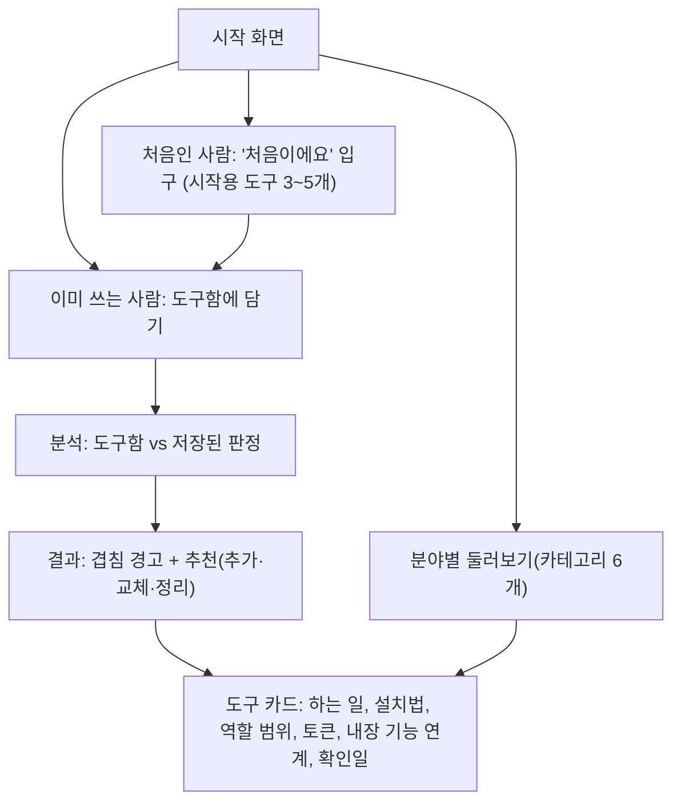
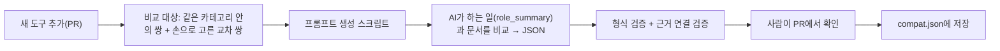
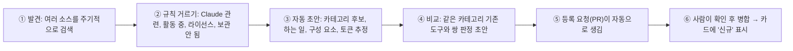

# 프로젝트 기획안 v2 (ROH 제안, 팀원 검토용)

> 이전 판(v1)에 **2026-10-16 결정 사항, 외부 검수 결과, 디자인 판정 파일럿을 반영**한 판입니다.
> 합의가 더 필요한 부분은 **[결정 필요]** 로 표시하고 9장에 모았습니다. 의견은 PR 코멘트나 줄 단위 리뷰로 남겨 주세요.

## 이번 개정에서 바뀐 것 (v1 → v2)
| 항목 | v1 | v2 (확정) |
|---|---|---|
| 기술 | 미정 (서버리스 검토) | **React + Tailwind + Spring** |
| 판정 방식 | 새 도구 추가 시 사전 분석, 나머지 실시간 | **미리 판정해 저장**하고, 저장되지 않은 조합일 때만 API로 판정 |
| 충돌의 뜻 | 같이 쓰면 문제가 생길 수 있음 | **비슷한 일을 하는 도구를 동시에 켜서 토큰이 낭비되는 것(겹침)**. 실제 오작동은 재현 기록이 있을 때만 별도 표시 |
| 안전성 표시 | 판정축 중 "안전성" | **"역할 범위"**: 이 도구가 어디까지 할 수 있는지를 사실로 표시. 안전·위험 단정 금지 |
| 토큰 표시 | 방향(▲▼)만, 숫자 없음 | **방향 + 추정 숫자(라벨 필수)** |
| 카테고리 | 효과별 6개 | **분야별 6개** (아래 5장) + "처음이에요" 입구 |
| 카탈로그 | 30~50개 시작 | **카테고리당 4개 이상, 6개 × 6 = 36개로 시작**, 가능하면 늘림 |
| 묶음형 저장소 | 저장소 1개 = 도구 1개 | 묶음은 **"전체 설치 기준"** 으로 표시, 일부만 설치하는 경우는 후순위 |
| 신선도 | `needs_review`만 | **확인일, 버전, "확인 이후 업데이트 있음"** 을 카드에 표시 |
| 태그 | 도구 태그로 후보 거르기 | **MVP에서는 쓰지 않음.** 같은 카테고리 안 쌍 + 손으로 고른 교차 쌍만 비교 |
| 새 도구 발견 | 기존 도구의 값(별 수 등)만 갱신 | **새로 나온 도구를 자동으로 찾아 후보로 올리고, 기존 도구와 비교한 차이를 붙여 사람이 확인한 뒤 추가** (3단계) |

## 목차
1. 한 줄 요약
2. 왜 이 주제로 왔는가 (고민 과정)
3. 해결하려는 문제
4. 기존 서비스 조사와 차별점
5. 사용자가 보게 될 흐름과 카테고리
6. 내부 동작 방식 (핵심)
7. 만드는 순서(단계)
8. 위험과 대응
9. 결정이 필요한 것
10. 참고 링크

---

## 1. 한 줄 요약

> 내가 쓰는 Claude 도구를 웹에서 직접 담으면, **비슷한 일을 하는 도구가 겹쳐서 토큰이 낭비되는지 알려 주고, 더 쓰면 좋은 도구는 추천**해 주는 한국어 웹 서비스.

- 형태는 **웹**입니다. 내 컴퓨터를 자동으로 읽지 않고, 사용자가 사이트에서 직접 고릅니다.
- **메인은 AI 판정**(겹침·보완·토큰 영향·역할 범위)이고, **서브는 분야별 도구 소개**입니다. 소개는 판정 결과를 설명하는 카드 역할도 합니다.
- 결과는 AI가 만들기 때문에 **무엇이 사실이고 무엇이 AI 추정인지, 언제 확인했는지**를 항상 함께 보여 줍니다.

---

## 2. 왜 이 주제로 왔는가 (고민 과정)

| 순서 | 생각 | 바뀐 이유 |
|---|---|---|
| 1 | Claude를 잘 쓰게 해 주는 오픈소스·플러그인이 많은데 설명이 영어뿐이니, 카테고리별로 모아 한국어로 소개하자 | 출발점 |
| 2 | 소개만 하면 영어권 대형 목록과 비슷해 보인다. **무엇이 다른가?** | 기존 서비스를 조사해 보니 "모아서 분류하기"는 이미 많음 |
| 3 | 비슷한 도구를 여러 개 깔았다가 **겹치거나 꼬여서 하나만 쓰게 되는** 일을 설치 전에 알려 주자 | 이 부분이 비어 있는 자리로 보였음 (조사 범위 안에서) |
| 4 | 충돌만 알려 주면 "하지 마세요"뿐이다. **추천도 같이** 하자 | 사용자가 얻는 것이 분명해짐 |
| 5 | 웹에서 내 컴퓨터를 자동으로 읽을 수 없고 설정 파일에 키가 섞일 수 있다. **도구함(직접 담기)** 방식으로 가자 | 구현이 쉽고 개인정보 위험이 작음 |
| 6 | 처음 쓰는 사람은 도구함이 비어 있다. **시작 입구**를 따로 두자 | 초보자 대상 유지 |
| 7 | Claude에 이미 있는 내장 기능을 몰라서 오픈소스를 또 깐다. **내장 기능과 함께 쓰는 법**도 알려 주자 | 공식 문서 확인 후 반영 |
| 8 | (v2) "같은 훅 시점"만으로는 충돌이라 할 수 없다. **비슷한 기능을 동시에 켜는 것 자체가 토큰 낭비**이니 그것을 충돌(겹침)의 기준으로 삼자 | 근거를 댈 수 있고 사용자에게 실제 이득이 있음. Codex 검수에서 같은 훅 시점이 충돌 증거가 아니라는 지적 |
| 9 | (v2) 카테고리 9개는 처음 온 사람에게 많고 기준이 섞여 있다(기능 + 직군). **6개로 줄이고 "처음이에요" 입구를 두자** | 진입 장벽 |

### 검토했다가 이번엔 고르지 않은 주제 (참고)
| 주제 | 안 고른 이유 |
|---|---|
| 팀플 기여도 대시보드 | 기여 기준 설계가 어렵고 사용자가 같은 수업 학생들로 한정됨 |
| 첫 기여 도우미(good first issue 모음) | 비슷한 사이트가 이미 있을 가능성이 높음 |
| 오픈소스 문서 번역 현황판 | 번역 PR이 받아들여질지 통제할 수 없음 |
| 특정 도메인 MCP 서버 | "왜 이 주제인가"를 설명하기 어려움 |

---

## 3. 해결하려는 문제

1. **정보가 흩어져 있고 영어 중심**: 쓸 만한 도구가 어디 있는지 찾기 어렵다.
2. **소개만 있고 판단은 없음**: 도구를 모아 둔 곳은 많지만 내 상황에 맞는지는 알려 주지 않는다.
3. **설치 전에는 겹침을 모름**: 비슷한 일을 하는 도구를 여러 개 켜 두면 같은 일에 토큰이 여러 번 쓰인다.
4. **내장 기능을 모르고 중복 설치**: 이미 있는 기능과 같은 일을 하는 오픈소스를 또 설치한다.

---

## 4. 기존 서비스 조사와 차별점

### 4-1. 조사 (조사일 2026-10-15, 공개 페이지에서 확인한 범위)
| 서비스 | 하는 일 | 비고 |
|---|---|---|
| claudepluginhub | 설치 점검(Doctor), 환경 맞춤 추천(Recommender) | 영어 |
| claudemarketplaces.com | 대형 카탈로그, 카테고리·인기순 | 영어 |
| claudeskills.info | 색인 42,249개, 설치 수 순위 | 한국어 페이지 있음 |
| Claude Code 공식 기능 | `/plugin`, `claude plugin details` | 아래 4-2 |

로그인·유료 영역은 확인하지 못했습니다. MCP 서버 디렉터리의 규모는 제3자 글 기준이라 **대략적인 규모**로만 참고하세요. 경쟁 서비스의 최신 기능은 이번에 다시 확인하지 않았으므로 발표 때 확인일을 함께 말합니다.

### 4-2. 공식 문서에서 확인한 내용 (2026-10-15)
| 주제 | 공식 기능 | 우리와의 관계 |
|---|---|---|
| 토큰 비용 | `claude plugin details 이름`이 매 세션 추가되는 토큰(Always-on)을 보여 줌. 추정치이고 **훅·MCP 서버는 계산에서 빠짐**. 설치 전 `/plugin`에서 비용을 보여 주는 것은 공식 마켓플레이스 플러그인만 | 그 밖의 도구는 설치 전 비용 표시가 없음 → 우리가 채움(라벨 필수) |
| 안 쓰는 것 정리 | `/plugin`의 "Not used recently", `/doctor`, `/skill-doctor` | 이미 있음. 우리는 안내만 |
| 추천 | 마켓플레이스 운영자가 `relevance`를 정의하면 상황에 맞는 플러그인을 제안. 관리자 허용 필요 | 작업 신호 기반이고 조직용. 우리는 "내 도구함 기준" |
| 충돌 | 플러그인 의존성의 **버전 범위 충돌**을 다룸 | 기능 중복이나 이름 충돌을 감지하는 기능은 읽은 페이지에서 **확인하지 못함** (없다는 뜻은 아님) |

### 4-3. 차별점 (한 문장씩)
1. **내 도구함 기준으로 겹침**(비슷한 일을 하는 도구를 같이 켜서 낭비되는 토큰)을 설치 전에 알려 준다.
2. 도구가 **어디까지 할 수 있는지(역할 범위)** 를 사실로 보여 준다.
3. 내 도구함을 보고 **추가·교체·정리**를 추천한다.
4. 내장 기능과 오픈소스를 **함께 쓰는 법**까지 안내한다.
5. 한국어 설명과 **확인일·확인 수준 공개**.

> "비어 있다"는 표현은 **위 조사 범위 안에서만** 성립합니다. 발표 때도 "확인한 범위에서는"이라고 말합니다.

---

## 5. 사용자가 보게 될 흐름과 카테고리



### 카테고리 6개 (분야별)
| # | 카테고리 | 한 줄 설명 |
|---|---|---|
| 1 | 기획·작업 방식 | Claude가 일하는 순서와 계획을 정함 |
| 2 | 토큰·컨텍스트 | 토큰을 줄이고 맥락·사용량을 관리 |
| 3 | 코드 이해·검색 | 코드와 기술 문서를 찾고 이해하게 도움 |
| 4 | 디자인·프론트엔드 | 화면을 만들고 다듬음 |
| 5 | 백엔드·인프라 | 서버·DB·클라우드 작업 |
| 6 | QA·테스트 | 테스트·리뷰·보안 점검 |

규칙:
- **한 도구의 대분류는 하나.** 둘 이상에 걸치면 주된 사용 목적 하나만 고른다.
- 카테고리 이름은 모두 "무슨 일을 하는가"로 통일한다 (직군 이름을 쓰지 않는다).
- 카테고리마다 **"이럴 때 찾으세요"** 예시를 하나 붙인다.

### 화면 구성
| 화면 | 역할 |
|---|---|
| 시작 | 두 입구(이미 쓰는 사람 / 처음인 사람) |
| 도구함 | `쓰는 중` / `써볼 예정`으로 담기. 목록에 없는 도구는 메모로만 남김(비교 대상 아님, 결과에 "미확인 도구 있음" 표시) |
| 결과 | 겹침 경고, 추천, 항목별 근거와 확인 수준 |
| 도구 카드 | 한국어 설명, 설치 방법, 역할 범위, 토큰, 내장 기능 연계, **확인일과 업데이트 여부** |
| 둘러보기 | 카테고리 6개, 별 수·최근 업데이트순 정렬, 검색 |

---

## 6. 내부 동작 방식 (핵심)

### 6-1. 데이터는 세 종류
1. **도구 데이터** (`entries.json`): 도구 하나당 한 건
2. **판정 데이터** (`compat.json`): 도구 두 개의 관계, **분석한 쌍만** 저장
3. **내 도구함**: 사용자별 선택 목록

#### 도구 데이터 예시 (이름은 가짜입니다)
```json
{
  "id": "tool-a",
  "repo": "owner/tool-a",
  "aliases": [],
  "name": "tool-a",
  "category": 2,
  "summary_ko": "한 줄 설명",
  "role_summary": "어떤 일을 맡는지 한두 줄 (비슷한 기능인지 판단하는 기준)",
  "install_basis": "전체 설치",
  "version": "1.2.3",
  "checked_at": "2026-10-16",
  "scope": {
    "skills": 3, "agents": 0, "commands": 2, "mcp": 0,
    "hooks_total": 1, "hook_events": { "SessionStart": 1 }
  },
  "always_on_tokens_est": 700,
  "token_effect": "down",
  "token_note": "제작자 주장",
  "install": "설치 방법",
  "cautions": "주의할 점",
  "reviews": [{ "title": "후기 글 제목", "url": "https://...", "source": "블로그" }],
  "auto": { "stars": 0, "pushed_at": "", "license": "", "open_issues": 0 }
}
```
- `id`는 내부 번호이고, 저장소 주소(`repo`)는 바뀔 수 있어서 이전 주소를 `aliases`에 보관합니다.
- `install_basis`: 묶음형 저장소는 **"전체 설치"** 기준이라고 카드에 적습니다. 일부만 설치하는 경우의 판정은 **후순위**입니다.
- `scope`는 코드가 센 사실이고, 사람이 쓰지 않습니다. **"모든 도구 호출에 걸리는 훅"처럼 해석이 필요한 항목은 시점별로 나눠 센 뒤에 사용합니다.**
- `auto` 아래 값은 자동 갱신이 채웁니다.

#### 판정 데이터 예시
```json
{
  "a": "tool-a",
  "b": "tool-b",
  "relation": "overlap",
  "reason_ko": "둘 다 세션 기억을 맡아서 함께 켜면 같은 일에 토큰이 두 번 쓰입니다",
  "evidence": [
    { "claim": "둘 다 세션 기억 기능", "type": "doc", "source": "각 README", "checked_at": "2026-10-16" },
    { "claim": "상시 토큰 합 약 N (이름·설명 기준 추정)", "type": "calc" }
  ],
  "a_version": "1.2.3",
  "b_version": "0.9.0",
  "judged_at": "2026-10-16",
  "criteria_version": "v1",
  "review_state": "ai_estimate",
  "needs_review": false
}
```

**관계 5종**
| 관계 | 뜻 | 사용자에게 |
|---|---|---|
| `overlap` 겹침 | 비슷한 일을 해서 동시에 켜면 토큰이 낭비됨 | 하나만 쓰기를 권장, 하나 끄면 줄어드는 양(추정) 표시 |
| `situational` 용도별 | 상황에 따라 골라 쓰는 게 나음 | 용도별로 나눠 쓰기 |
| `complement` 보완 | 함께 쓰면 좋음 | 추천 후보 |
| `none` 관련 없음 | 분석했지만 뚜렷한 관계가 없음 | 표시하지 않거나 "관련 없음" |
| `verified_issue` 동작 문제 확인됨 | 같이 켜서 실제로 문제가 **재현된** 기록이 있음 | 재현 조건과 함께 경고. 기록이 없으면 이 관계는 쓰지 않음 |

**근거 종류 (주장마다 따로 붙임)**
`calc`(코드가 계산) / `doc`(문서 근거, 제작자 주장은 그렇게 표시) / `tested`(우리가 직접 확인, 날짜·모델·과제 수 기록) / `ai`(AI 추정)
- **검수 상태**(AI 추정 / 사람 검토 / 직접 확인)는 근거 종류와 **별도 필드**입니다.
- 여러 AI의 합의는 내부 참고용이고, 정확성을 보증하지 않습니다.

> 핵심 규칙: **분석하지 않은 쌍은 "안전"이 아니라 "확인된 정보 없음"** 으로 표시합니다. "관련 없음"은 분석한 뒤의 결과이고 "확인된 정보 없음"과 다릅니다.

### 6-2. 겹침은 어떻게 알아내는가



- **태그는 쓰지 않습니다.** 36개 규모에서는 같은 카테고리 안의 쌍(카테고리당 15쌍, 총 약 90쌍)과 교차 쌍 몇 개면 충분합니다. 태그는 카탈로그가 수백 개로 늘면 도입합니다.
- 각 도구의 **하는 일(`role_summary`)** 한 줄이 "비슷한 기능인가" 판단의 기준입니다. 이 값은 사람이 검수합니다.
- AI에게 기억에 의존해 답하게 하지 않고, 각 도구의 설명·구성 요소 글을 직접 넣어 줍니다.
- 같은 훅 이벤트를 쓴다는 사실만으로는 겹침이라고 하지 않습니다. **"같은 시점에 실행됨"까지는 사실로 표시**하고, 겹침은 하는 일이 같을 때만 판정합니다.

### 6-3. 판정 저장과 새 조합 처리 (확정)
**기본은 미리 판정해 저장**하고, **저장되지 않은 조합일 때만 API로 판정**합니다.

| 상황 | 동작 |
|---|---|
| 등록된 도구, 유효한 저장 판정 있음 | 저장된 결과와 확인일을 보여 줌 |
| 등록된 도구, 판정이 저장되지 않은 쌍 | API로 분석해 "AI 추정, 미검수" 표시로 저장·재사용 |
| 도구함 순서만 바뀜, 중복 선택 | 쌍을 정렬·중복 제거해 같은 결과 재사용 |
| 목록에 없는 도구 | 메모로만 남기고 비교 제외, 결과에 "미확인 도구 있음" |
| 도구가 업데이트됨 | 카드에 **"확인 이후 업데이트 있음(기능 변화는 미확인)"** 표시, 갱신 대기 |
| API 실패·한도 초과 | 확인된 사실(구성 요소, 토큰 추정)만 보여 주고 "미분석"으로 표시 |
| 도구 0~1개 | 충돌 분석 없음, 시작 추천이나 도구 설명 |
| 3개 이상 조합 | "확인한 쌍의 범위에서"라고 표시. 전체 조합이 정상이라는 보증이 아님 |

- 미검수 즉시 생성 결과는 사전 검수 결과와 **다른 표시**로 보여 줍니다.
- 요청당 도구 수와 호출량을 제한하고, 같은 쌍의 동시 요청은 한 번만 분석합니다.
- 도구 설명은 명령이 아니라 **분석 자료로만** 취급합니다(프롬프트 주입 대비).

### 6-4. 확인일과 업데이트 표시 (확정)
카드와 결과 화면에 다음 세 가지 중 하나를 보여 줍니다.
- `확인일 2026-10-16 · 최신`
- `확인 이후 저장소가 업데이트됨 (기능 변화는 미확인)`
- `분석 안 됨`

저장소가 업데이트됐다고 판정이 틀렸다는 뜻은 아니므로, 화면에서 "틀림"처럼 읽히지 않게 씁니다. 판정에는 두 도구의 버전과 판정 기준 버전도 함께 저장해서 조건이 달라진 판정은 재사용하지 않습니다.

### 6-5. 추천은 어떻게 하는가
추천은 **규칙으로 후보를 뽑고, AI는 이유만 설명**합니다. AI가 자유롭게 고르게 하면 없는 도구를 지어낼 수 있기 때문입니다.

| 종류 | 후보를 뽑는 규칙 | 보여 주는 것 |
|---|---|---|
| 추가 | 도구함의 도구와 `complement`(보완) 관계인 것 | 왜 필요한지 |
| 교체 | 도구함의 도구와 같은 역할(`overlap`)이면서 더 나은 대체 후보 | 비교 근거(별 수, 최근 업데이트, 라이선스, 근거 종류) |
| 정리 | 도구함 안에서 `overlap`이거나 내장 기능으로 충분한 것 | 빼도 되는 이유, 줄어드는 토큰(추정) |

**공통 규칙**
1. 후보는 먼저 도구함과의 겹침 검사를 통과해야 합니다. **판정이 없는 쌍은 "통과"가 아니라 "미확인"** 입니다.
2. 추천은 **카탈로그에 있는 도구만** 가능합니다.
3. 비어 있는 카테고리라고 해서 곧 필요한 도구는 아닙니다. 사용자가 고른 목적이 있으면 그것을 기준으로 합니다.
4. "인기 많고 최신"만으로 교체를 권하지 않습니다.
5. 도구함이 비었으면 시작 조합을, 이미 충분하면 "추가 추천 없음"을 반환합니다.

### 6-6. 판정에서 보여 주는 것 (판정축)
| 항목 | 보는 것 | 근거 |
|---|---|---|
| 겹침 | 도구함의 도구와 같은 일을 하는가 | doc + ai |
| 보완성 | 비어 있는 영역을 채우는가 | doc + ai |
| **역할 범위** | 구성 요소(스킬·에이전트·명령·MCP), 훅 개수와 **실행 시점별 개수**, 읽기/쓰기 대상 | calc / doc |
| 유지보수 | 최근 업데이트, 릴리스, 라이선스 | calc (GitHub) |
| 초보자 적합도 | 설치·설정 난이도 | ai |

- 점수 하나로 합치지 않고 **항목별 표시 + 한 줄 이유**로 보여 줍니다. 별 수·인기는 보조 신호입니다.
- **"위험도 낮음/보통/주의"는 쓰지 않습니다.** "안전합니다" 같은 단정 표현도 쓰지 않고, 카드마다 "도움말이며 보증이 아닙니다"를 고정으로 둡니다.
- 문구 예: "훅 22개가 7가지 시점에 실행됩니다. 설치 전에 범위를 확인하세요."
- 정규식 패턴 검사(네트워크 호출, 민감 경로 등)는 오탐이 많아서 **화면에는 쓰지 않고** 검수 참고용으로만 씁니다.
- 확인하지 못한 항목은 "확인 안 됨"으로 표시하고, 개수 0이나 불가능으로 쓰지 않습니다.

### 6-7. 토큰: 방향과 추정 숫자
- 카드에 `늘 수 있음 ▲` / `줄일 수 있음 ▼` / `영향 적음 ―` 중 하나를 붙입니다.
- **상시 비용 추정(숫자)** 도 보여 줍니다. 단 범위를 라벨로 밝힙니다: **"스킬·에이전트·명령의 이름·설명 분량 기준 추정(글자수÷3). 훅·MCP의 실제 비용은 포함되지 않음"**.
- 겹침 판정에서는 "둘 다 켜면 약 N, 하나만 쓰면 약 M"처럼 **추정 차이**로 보여 줍니다.
- 절약 효과(도구가 토큰을 줄여 준다는 주장)는 별도 근거가 없으면 `제작자 주장` 또는 `확인 안 됨`으로 둡니다.
- 합산은 같은 집계 기준·같은 활성 조건에서만 합니다.

### 6-8. 애매한 "품질"은 이렇게 다룬다 (파일럿으로 확인됨)
"품질이 좋아진다"고 쓰지 않고, **측정한 항목**으로 쪼개서 근거 종류와 함께 보여 줍니다. 자세한 방법은 [judgment-criteria.md](judgment-criteria.md) 3장.
- **도구가 겨냥한 축**(설명서에서 뽑음, 제작자 주장)과 **우리가 측정한 축**(결과물을 실제로 그려서 자동 측정)을 **따로** 표시합니다. 도구가 겨냥한 것(예: 개성)과 측정되는 것(예: 간격 일관성)이 다를 수 있기 때문입니다.
- 자동으로 잴 수 있는 것: 간격 격자, 이모지 아이콘, 키보드 포커스·모션 감소 대응, 글꼴 수, 글자 대비. 사람이 보는 것: 정보 위계, 목적 적합성, 개성(두 사람이 따로 채점).
- 파일럿(12쪽, 무료 모델, 설명서 주입)에서 간격 일관성(도구 없음 42% → impeccable 90%)과 이모지 아이콘(7곳 → 0곳) 등은 구별됐고, 글자 대비는 과제 영향이 더 커서 불분명했습니다. **표본이 작아 방법 확인용**이고 도구의 우열 증거는 아닙니다 ([design-pilot-result.md](design-pilot-result.md)).
- 직접 확인은 **대표 도구 2~3개**로 시작하되 조건당 10쪽 이상, 과제 3개 이상, 같은 과제 안에서만 비교합니다.
- 화면에는 "이 과제·조건에서 이 항목이 달라졌다"까지만 쓰고, 날짜·모델·도구 버전을 같이 표시합니다. "더 예뻐졌다"는 쓰지 않습니다.

### 6-9. 내장 기능과 함께 쓰는 법
도구 카드에 3칸을 둡니다: `내장 기능으로 되는 것` / `오픈소스가 더해 주는 것` / `함께 쓰는 법`.
- 내장 기능은 버전마다 바뀌므로 `source_url`, `checked_at`, `min_version`을 저장합니다.
- 공식 문서 전체 목록은 `https://code.claude.com/docs/llms.txt` 에서 찾을 수 있습니다. 카드에 넣기 전에 **사람이 원문과 한 번 대조**합니다.
- 범위는 대표 내장 기능 몇 개와 대표 조합으로 제한합니다. (MVP 이후)

### 6-10. 자동 갱신과 새 도구 자동 발견 (3단계)

두 가지가 있습니다. **① 이미 있는 도구의 정보 갱신**, **② 새로 나온 도구의 발견·추가**.

#### ① 기존 도구 정보 갱신
- GitHub API로 별 수, 마지막 업데이트, 라이선스, 열린 이슈 수, 마지막 릴리스를 가져와 `auto` 값을 갱신합니다.
- `pushed_at` 변경만으로 기능이 바뀌었다고 단정하지 않고 "업데이트 있음"까지만 표시합니다(6-4).
- 라이선스가 `NOASSERTION`이거나 없으면 "확인 필요"로 표시합니다.

#### ② 새 도구 자동 발견 → 후보 등록 (새로 나온 좋은 도구가 우리 쪽에 올라오게)
**자동으로 하는 것**은 *찾기 · 초안 만들기 · 기존 도구와 비교하기 · 등록 요청(PR) 만들기*까지이고, **공개 카탈로그에 올리는 것은 사람이 확인한 뒤**입니다.



1. **발견 소스는 여러 개를 합칩니다.** GitHub 토픽 하나만 쓰면 놓치는 것이 많았습니다(우리 시험에서 토픽만으로는 유명한 도구 39개 중 6개를 놓쳤고, 토픽 + 키워드 + awesome 목록을 합치자 39개를 모두 찾았습니다). 추가 소스: 공식 마켓플레이스 목록, 별 증가가 빠른 저장소.
2. **규칙으로 먼저 거릅니다.** Claude/Anthropic 언급, 최근 180일 내 업데이트, 보관(archived) 아님, 최소 별 수, 라이선스 확인 가능. 이 단계는 AI 없이 코드로 합니다.
3. **자동 초안**: 카테고리 후보, 하는 일(`role_summary`) 초안, 구성 요소 개수, 상시 토큰 추정을 만듭니다. 전부 **"AI 초안, 미검수"** 로 표시합니다.
4. **기존 도구와 비교**: 같은 카테고리 안의 도구들과 쌍 판정 초안을 만들어 저장합니다(6-2와 같은 방식, 새 도구 1개당 카테고리 안 5~6쌍).
5. **"기존보다 낫다"는 단정하지 않고, 비교 가능한 차이만 보여 줍니다.**

   | 비교 항목 | 근거 종류 |
   |---|---|
   | 최근 업데이트, 별 증가 속도, 라이선스 | calc (GitHub) |
   | 상시 토큰 추정이 더 낮은가 | calc (이름·설명 기준 추정) |
   | 역할 범위(구성 요소 수)가 더 좁은가 | calc |
   | 하는 일이 같은데 더 나은 점 | doc (제작자 주장으로 표시) |
   | 실제로 품질이 더 좋은가 | **직접 확인 전에는 쓰지 않음** |

   기존 도구보다 위 지표가 앞서면 **"교체 후보"** 로 표시해서 사람의 확인 순서를 앞당깁니다.
6. **카테고리마다 정식 카탈로그는 상한을 둡니다(예: 6~10개).** 신규 후보는 "후보 목록"에 두고, 사람이 승인하면 정식으로 올립니다. 정식 카탈로그가 가득 차 있으면 기존 도구 중 가장 뒤처진 것과 교체할지 사람이 정합니다.

**왜 완전 자동으로 올리지 않는가**
- 도구의 설명(README)은 AI에게 보내는 글이라 **프롬프트 주입**이 섞일 수 있고, 별 수는 조작될 수 있습니다.
- AI만으로 도구가 안전하다고 보증할 수 없습니다.
- 그래서 AI는 초안과 비교만 만들고, **마지막 승인은 사람**입니다. 사용자 화면에는 상태를 표시합니다: `후보(AI 초안)` → `사람 확인됨`.

**진행 순서**: 먼저 손으로 실행하는 스크립트(우리가 이미 만든 수집 스크립트가 출발점)를 완성하고, 그다음 GitHub Actions로 주기 실행(예: 주 1회)을 붙입니다. Actions가 막혀도 수동 실행까지는 동작합니다.

**비용**: 규칙 거르기는 AI를 쓰지 않아 비용이 없고, AI는 규칙을 통과한 소수의 후보에만 씁니다.

공통 규칙: 토큰은 코드나 저장소에 넣지 않고 Actions의 기본 토큰이나 Secrets를 씁니다. 다른 사이트의 설치 수를 긁어오지 않습니다.

### 6-11. 서버와 AI 호출 (확정: Spring)
- **React + Tailwind**(화면), **Spring**(서버, 판정 조회·API 호출·저장).
- 키는 서버 환경변수에만 두고, 요청 횟수·입력 길이 제한, 일일 금액 상한, 결과 저장 후 재사용을 지킵니다.
- 판정 저장소는 처음엔 JSON, 필요하면 DB로 옮깁니다. (DB를 쓰면 SQL injection 등 입력 검증을 점검합니다.)
- 서버 보안 체크리스트(입력 검증, 키 관리, 호출 제한, 프롬프트 주입 대비)는 우리 서비스 기준으로 작성합니다.

### 6-12. 후기
- 팀이 고른 후기 글·영상 **링크**를 항목마다 1~3개 답니다. 본문은 복사하지 않습니다.
- 댓글(giscus), 후기 자동 수집·번역은 **후순위**입니다.

---

## 7. 만드는 순서(단계)

| 단계 | 내용 |
|---|---|
| **MVP** | React+Tailwind 화면, Spring 서버, **카탈로그 36개(6개 카테고리 × 6)**, 검색·필터, 도구함, 도구 카드(역할 범위·토큰 추정·확인일), 사전 판정 저장, 미저장 쌍 API와 재사용, 미확인·갱신 필요·실패 상태, 대표 직접 확인 2~3조합 |
| **2단계** | 처음인 사람용 입구(시작용 도구 추천), 교체·정리 추천, 카탈로그 확대(겹침이 많은 분야부터) |
| **3단계** | 자동 갱신(GitHub API + Actions), **새 도구 자동 발견 → 후보 등록 요청 → 사람 확인 후 추가(6-10)**, 내장 기능 연계 가이드(대표 사례), 검증 과정 공개 페이지 |
| **후순위** | 로그인과 DB 동기화, 댓글 위젯, 후기 자동 수집, 다중 AI 투표 공개, 묶음 저장소의 일부 설치 판정, 상시 자동 갱신 |

- 중간에 시간이 부족해도 **MVP까지는 쓸 수 있는 서비스**로 남는 순서입니다.
- 대표 판정 **1건을 끝까지 완주**(수집 → 판정 → 저장 → 화면 표시 → 업데이트 표시)하는 것이 첫 목표입니다.

### 지금까지 만든 것 (2026-10-16 기준)
- 오픈소스 후보 **2,524개** 수집(GitHub 3가지 방법) + NotebookLM deep 조사 6개로 신규 210개 → **214개 분류, 핵심 36개 선별 중**
- 내 환경 스캐너와 훅 점검 프로토타입으로 **실측 3종**(superpowers, impeccable, ECC) 확보. 훅 개수는 시점별로 다시 집계했고, 세션 시작·응답 종료 훅은 실제 실행 기록으로 확인함(2026-10-17). 상시 토큰은 글자수÷3 추정이 ECC에서 실측의 약 3배로 나와 실측값을 우선함
- Codex 외부 검수 1회 완료, 지적 사항을 이 문서에 반영
- **디자인 판정 파일럿**(12쪽 생성 → Chrome으로 실제 렌더 → 자동 측정): 설명서에서 겨냥 축을 뽑고 자동 측정하는 방법이 무료 도구만으로 끝까지 동작함을 확인 (6-8장)

---

## 8. 위험과 대응

| 위험 | 대응 |
|---|---|
| 분류가 사람마다 달라짐 | 카테고리 기준표와 "이럴 때 찾으세요", PR 리뷰에서 확인 |
| AI 판정이 틀림 | 근거 종류·검수 상태 표시, 표본 사람 확인, 이의 제기(이슈) |
| "비슷한 기능"의 판단이 AI 해석에 의존 | `role_summary`를 사람이 검수하고, 근거(문서 출처)를 판정에 연결 |
| 토큰 추정이 실제와 다름 | 라벨로 범위(이름·설명 기준, 훅·MCP 제외)를 밝히고 "추정"으로만 표시 |
| 묶음형 저장소를 부분 설치하는 경우 | MVP는 "전체 설치 기준"으로 표시, 부분 설치는 후순위 |
| 저장된 판정이 오래됨 | 확인일·버전 저장, "확인 이후 업데이트 있음" 표시, 갱신 대기 |
| 별 수가 품질·안전을 보장하지 않음 | 유지보수·라이선스·역할 범위를 함께 표시 |
| 공식 기능이 비슷한 걸 추가함 | 발표에서 확인한 날짜 기준으로 말하고, 한국어·내 도구함 기반·확인 수준 공개를 강점으로 |
| 범위가 커짐 | 단계 순서 준수, MVP 먼저, 카테고리당 4개 이상으로 시작 |
| 직접 확인 실험의 작업량 | 핵심 2~3개 조합으로 시작 |
| AI 호출 비용 | 사전 판정 + 결과 재사용 + 금액 상한 |
| 자동 발견된 도구에 악성·조작(별 수, 프롬프트 주입)이 섞임 | 자동으로 공개하지 않고 `후보(AI 초안)` 상태로 두고 사람이 확인. 설명은 분석 자료로만 취급, 별 수는 보조 신호 |
| 신규 후보가 너무 많이 쌓임 | 규칙 거르기(Claude 관련·활동·라이선스)와 카테고리별 정식 카탈로그 상한 |
| 수집 데이터의 출처 기록 부족 | 수집일·중복 제거·제외 기준을 문서로 남기고 도구마다 수집일 저장 |
| 다른 과목 프로젝트와 주제 중복 | 담당 교수님께 주제 확인 |

---

## 9. 결정이 필요한 것

**확정됨 (2026-10-16)**
- [x] 기술 구성: React + Tailwind + Spring
- [x] 판정 방식: 미리 저장 + 저장 안 된 조합만 API
- [x] 충돌의 뜻: 비슷한 기능의 동시 사용으로 인한 토큰 낭비(겹침)
- [x] 안전성 표시: 역할 범위(안전·위험 단정 금지)
- [x] 카테고리 6개 + "처음이에요" 입구, 카테고리당 4개 이상으로 시작
- [x] 묶음형 저장소: "전체 설치 기준"
- [x] 확인일·업데이트 여부 표시
- [x] MVP에서 태그 미사용

**남은 결정**
- [ ] **프로젝트 이름** (지금은 "AI 도구 인벤토리" 가칭)
- [ ] **36개 최종 목록** (카테고리별 6개, 라이선스·업데이트 확인 후 확정)
- [ ] 각 도구의 **하는 일(`role_summary`) 작성과 검수 방법**
- [ ] **직접 확인할 대표 조합 2~3개**와 채점할 사람
- [ ] 미저장 쌍 API: 사용할 AI 종류, 일일 금액 상한, 호출 제한
- [ ] 판정 저장소: JSON으로 시작할지, 처음부터 DB를 쓸지
- [ ] **새 도구 자동 발견**: 주기(주 1회?), 발견 소스 목록, 후보로 올리는 최소 기준(별 수·최근성), 카테고리별 정식 카탈로그 상한, 누가 승인할지
- [ ] **역할 분담**: ① 수집·역할 범위 검수 / ② 판정 기준·검수 / ③ 웹·서버 (담당자 이름)
- [ ] **일정**: 제안서 발표, 중간 보고, 최종 발표 날짜에 맞춘 단계 배치
- [ ] 담당 교수님께 **주제 중복 여부** 확인 (누가 문의할지)

---

## 10. 참고 링크

공식 문서 (2026-10-15 확인, 문서는 자주 바뀝니다)
- 문서 전체 목차: https://code.claude.com/docs/llms.txt
- 플러그인 설치 및 관리: https://code.claude.com/docs/ko/plugins/install
- 플러그인 비용 측정: https://code.claude.com/docs/en/plugins/measure
- 플러그인 추천(relevance): https://code.claude.com/docs/en/plugins/relevance
- 플러그인 의존성: https://code.claude.com/docs/en/plugins/dependencies
- 훅: https://code.claude.com/docs/en/hooks

관련 문서
- 판정 기준 초안: [judgment-criteria.md](judgment-criteria.md)
- 디자인 판정 파일럿 결과: [design-pilot-result.md](design-pilot-result.md)
- 외부 검수(AI 1회)에서 나온 지적은 이 문서에 반영했습니다. 주요 내용: 같은 훅 시점만으로 충돌이라 할 수 없다, 묶음형 저장소는 설치 구성 기준으로 봐야 한다, 저장된 판정에는 유효 조건(버전·확인일)이 필요하다
