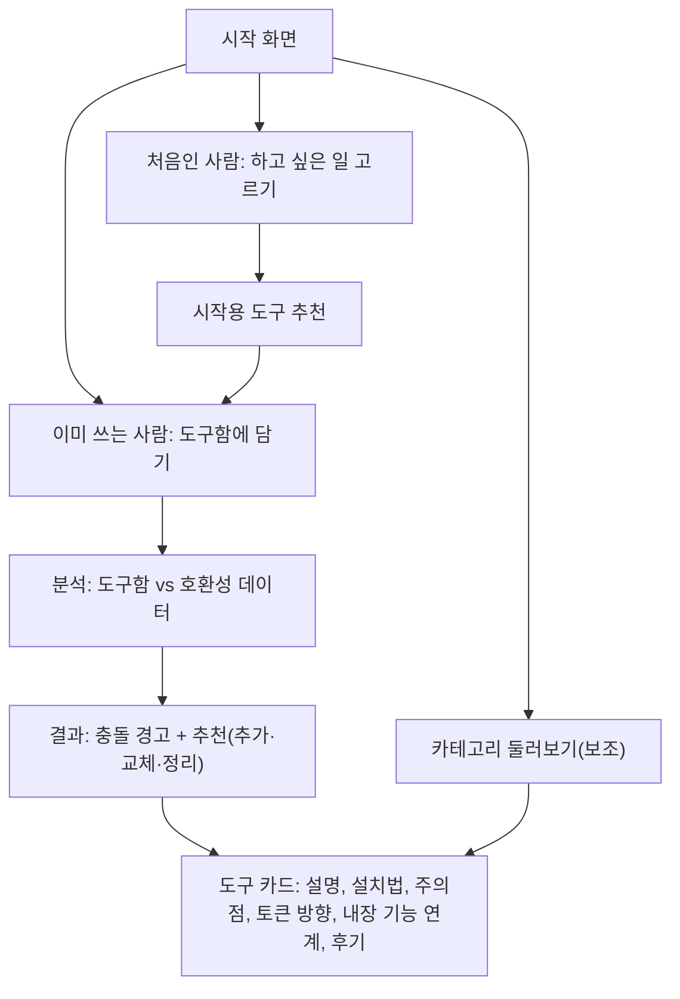

# 프로젝트 기획안 (ROH 제안, 팀원 검토용)

> 이 문서는 제안서 PPT(7장)에 다 담지 못한 **고민 과정, 내부 동작 방식, 근거**를 팀원이 함께 검토하려고 정리한 것입니다.
> 합의가 필요한 부분은 **[결정 필요]** 로 표시했고, 마지막 장에 모아 두었습니다.
> 의견은 이 PR의 코멘트나 줄 단위 리뷰로 남겨 주세요. 작성자 ROH, 작성 도움 Claude, 작성일 2026-10-15.

## 목차
1. 한 줄 요약
2. 왜 이 주제로 왔는가 (고민 과정)
3. 해결하려는 문제
4. 기존 서비스 조사와 차별점
5. 사용자가 보게 될 흐름
6. 내부 동작 방식 (핵심)
7. 만드는 순서(단계)
8. 위험과 대응
9. 결정이 필요한 것
10. 참고 링크

---

## 1. 한 줄 요약

> 내가 쓰는 Claude 도구를 웹에서 직접 담으면, **겹치거나 부딪히는 것은 알려 주고, 더 쓰면 좋은 도구는 추천**해 주는 한국어 웹 서비스.

- 형태는 **웹**입니다. 내 컴퓨터를 자동으로 읽지 않고, 사용자가 사이트에서 직접 고릅니다.
- 도구 소개(카테고리, 설치법, 주의점)는 따로 있는 기능이 아니라 **충돌·추천 결과를 설명하는 카드** 역할도 합니다.
- 결과는 AI가 만들기 때문에, **얼마나 확인된 정보인지**를 항상 함께 보여 줍니다.

---

## 2. 왜 이 주제로 왔는가 (고민 과정)

처음부터 지금 형태였던 것이 아니라, 아래 순서로 바뀌어 왔습니다.

| 순서 | 생각 | 바뀐 이유 |
|---|---|---|
| 1 | Claude를 잘 쓰게 해 주는 오픈소스·플러그인이 많은데 **설명이 영어뿐**이니, 카테고리별로 모아 한국어로 소개하자 | 출발점 |
| 2 | 소개만 하면 영어권 대형 목록과 비슷해 보인다. **무엇이 다른가?** | 기존 서비스를 조사해 보니 "모아서 분류하기"는 이미 영어권에 많음 |
| 3 | 사람들은 비슷한 도구를 여러 개 깔았다가 **겹치거나 꼬여서 하나만 쓰게 되는** 일을 겪는다. 이걸 설치 전에 알려 주자 | 이 부분이 비어 있는 자리로 보였음 (조사 범위 안에서) |
| 4 | 충돌만 알려 주면 "하지 마세요"뿐이다. **추천도 같이** 하자 | 사용자가 얻는 것이 분명해짐 |
| 5 | 사용자의 컴퓨터를 자동으로 읽는 건 웹에서 불가능하고, 설정 파일에는 키가 섞일 수 있다. **도구함(직접 담기)** 방식으로 가자 | 구현이 쉽고 개인정보 위험이 작음 |
| 6 | 처음 쓰는 사람은 도구함이 비어 있다. **시작 입구**를 따로 두자 | 초보자 대상이라는 목표 유지 |
| 7 | Claude에 이미 있는 내장 기능을 몰라서 오픈소스를 또 깐다. **내장 기능과 함께 쓰는 법**도 알려 주자 | 공식 문서 확인 후 반영 |

### 검토했다가 이번엔 고르지 않은 주제 (참고)
| 주제 | 안 고른 이유 |
|---|---|
| 팀플 기여도 대시보드 | 수업과 잘 맞지만, "커밋 수 = 기여"인지 기준 설계가 어렵고 사용자가 같은 수업 학생들로 한정됨 |
| 첫 기여 도우미(good first issue 모음) | 비슷한 사이트가 이미 있을 가능성이 높음 |
| 오픈소스 문서 번역 현황판 | 번역 PR이 상대 저장소에서 받아들여질지 통제할 수 없음 |
| 특정 도메인 MCP 서버 | 결과물이 코드 중심이지만 "왜 이 주제인가"를 설명하기 어려움 |

이 표는 결정을 되돌리자는 뜻이 아니라, **팀원도 같은 후보를 보고 판단**할 수 있게 남긴 것입니다.

---

## 3. 해결하려는 문제

1. **정보가 흩어져 있고 영어 중심**: 쓸 만한 도구가 어디 있는지 찾기 어렵고 설명이 대부분 영어
2. **내가 뭘 쓰는지 정리가 안 됨**: 여러 개 깔고 나면 지금 무엇을 쓰는지 한눈에 알기 어려움
3. **겹침·낭비를 설치 전에 알기 어려움**: 같은 일을 하는 도구가 겹치거나 토큰이 낭비돼도 미리 알 방법이 마땅치 않음
4. **내장 기능을 모르고 중복 설치**: 이미 있는 기능과 같은 일을 하는 오픈소스를 또 설치

---

## 4. 기존 서비스 조사와 차별점

### 4-1. 제안서에 적은 조사 (조사일 2026-10-15, 공개 페이지에서 확인한 범위)
| 서비스 | 하는 일 | 비고 |
|---|---|---|
| claudepluginhub | 설치 점검(Doctor), 환경 맞춤 추천(Recommender) | 영어 |
| claudemarketplaces.com | 스킬·MCP·마켓플레이스 대형 카탈로그, 카테고리·인기순 | 영어 |
| claudeskills.info | 색인 42,249개, 설치 수 순위 | 한국어 페이지 있음 |
| Claude Code 공식 기능 | `/plugin`, `claude plugin details` | 아래 4-2 참고 |

이 표는 제안서 작성 때 직접 확인한 내용이며, 로그인·유료 영역은 확인하지 못했습니다.
MCP 서버 디렉터리(Glama, mcp.so, Smithery, PulseMCP 등)가 수천~수만 개 규모로 있다는 점은 제3자 글 기준이라 **대략적인 규모**로만 참고하세요.

### 4-2. 공식 문서에서 확인한 내용 (2026-10-15에 문서 페이지를 읽고 정리)

| 주제 | 공식 기능 | 우리와의 관계 |
|---|---|---|
| 토큰 비용 | `claude plugin details 이름`이 매 세션 추가되는 토큰(Always-on)과 구성 요소별 비용을 보여 줌. 추정치이고 **훅·MCP 서버는 계산에서 빠짐**. 설치 전 `/plugin`에서 비용을 보여 주는 것은 **공식 마켓플레이스 플러그인만** | 그 밖의 도구는 설치 전 비용 표시가 없음 → 우리의 토큰 방향(▲▼) 표시가 채움 |
| 안 쓰는 것 정리 | `/plugin`의 "Not used recently", `/doctor`, `/skill-doctor` | 이미 있음. 우리 "정리" 추천은 이 기능을 안내 |
| 추천 | 마켓플레이스 운영자가 `relevance`(작업 디렉터리, 읽은 파일, 실행한 명령)를 정의하면 상황에 맞는 플러그인을 제안. **관리자가 허용해야 표시** | 작업 신호 기반이고 조직용. "내가 가진 도구를 보고 빈 곳을 채운다"는 우리 방식과 다름 |
| 충돌 | 플러그인 의존성에서 **버전 범위가 안 맞을 때의 충돌**을 다룸 | 기능 중복이나 이름 충돌을 선언·감지하는 기능은 읽은 페이지에서 **확인하지 못함** (없다는 뜻은 아님) |

### 4-3. 차별점 (한 문장씩)
1. 분류 기준이 **"얻고 싶은 효과"** 중심 (도구 종류 중심이 아님)
2. 설치 **전에** 내 도구함과 겹치는지 확인
3. 내 도구함을 보고 **추가·교체·정리**를 추천
4. 내장 기능과 오픈소스를 **함께 쓰는 법**까지 안내
5. 한국어 초보자 눈높이의 설명, 그리고 **검증 수준을 공개**

> 주의: "비어 있다"는 표현은 **위 조사 범위 안에서**만 성립합니다. 발표 때도 "확인한 범위에서는"이라고 말하는 것이 안전합니다.
> Claude Code가 빠르게 바뀌는 중이라, 공식 기능이 추가되면 차별점이 줄어들 위험이 있습니다 (8장 참고).

---

## 5. 사용자가 보게 될 흐름



### 화면 구성
| 화면 | 역할 |
|---|---|
| 시작 | 두 입구(이미 쓰는 사람 / 처음인 사람) |
| 도구함 | `쓰는 중` / `써볼 예정`으로 담기, 우리 목록에 없는 도구는 직접 입력(비교는 불가) |
| 결과 | 충돌·중복 경고, 추천, 각 항목의 근거와 확인 수준 |
| 도구 카드 | 한국어 설명, 설치 방법, 예시, 주의할 점, 보안 표시, 토큰 방향, 후기 링크·댓글 |
| 둘러보기 | 효과별 카테고리, 별 수·최근 업데이트순 정렬, 검색 |

---

## 6. 내부 동작 방식 (핵심)

### 6-1. 데이터는 세 종류
1. **도구 데이터** (`entries.json`): 도구 하나당 한 건
2. **호환성 데이터** (`compat.json`): 도구 두 개의 관계, **분석한 쌍만** 저장
3. **내 도구함**: 사용자별 선택 목록

#### 도구 데이터 예시 (이름은 가짜입니다)
```json
{
  "id": "owner/tool-a",
  "name": "tool-a",
  "tags": ["token-saving", "search"],
  "summary_ko": "한 줄 설명",
  "role_summary": "어떤 일을 맡는지 한두 줄",
  "components": { "skills": 3, "hooks": 1, "mcp": 0, "commands": 2 },
  "install": "설치 방법",
  "cautions": "주의할 점",
  "token_effect": "down",
  "token_reason": "컨텍스트를 줄여 줌 (제작자 주장)",
  "reviews": [{ "title": "후기 글 제목", "url": "https://...", "source": "블로그" }],
  "auto": { "stars": 0, "pushed_at": "", "license": "", "open_issues": 0 }
}
```
- `auto` 아래 값은 사람이 쓰지 않고 **자동 갱신**이 채웁니다.
- `id`는 저장소 주소(`소유자/저장소`)를 씁니다. 이름이 같거나 바뀌어도 헷갈리지 않게 하기 위해서입니다.

#### 호환성 데이터 예시
```json
{
  "a": "owner/tool-a",
  "b": "owner/tool-b",
  "type": "overlap",
  "reason_ko": "둘 다 같은 시점에 비슷한 일을 하므로 하나만 쓰는 것을 권장",
  "level": "multi-ai",
  "ai_votes": { "agree": 3, "total": 3 },
  "analyzed_at": "2026-10-15",
  "needs_review": false
}
```

**유형 4종**
| 유형 | 뜻 | 사용자에게 |
|---|---|---|
| `overlap` 중복 | 같은 일을 함 | 하나만 쓰기를 권장 |
| `conflict` 충돌 가능 | 같이 쓰면 문제가 생길 수 있음 | 같이 쓰지 않기 |
| `situational` 용도별 | 상황에 따라 골라 쓰는 게 나음 | 용도별로 나눠 쓰기 |
| `complement` 보완 | 함께 쓰면 좋음 | 추천 후보 |

**확인 수준 4단계**
`단일 AI 추정` → `여러 AI 합의` → `사람 확인` → `실제 설치 테스트`

> 핵심 규칙: **분석하지 않은 쌍은 "안전"이 아니라 "확인된 정보 없음"** 으로 표시합니다.
> 경고가 없다고 안전하다고 오해하지 않게 하기 위해서입니다.

### 6-2. 충돌·중복은 어떻게 알아내는가


- **모든 쌍을 다 비교하지 않습니다.** 새 도구 1개를 기존 도구들과만 비교하고, 그중 겹침이 큰 후보 5~10개만 AI에 보냅니다.
- AI에게 **기억에 의존해 답하게 하지 않고**, 각 도구의 설명·구성 요소 글을 직접 넣어 줍니다. (새 도구는 AI가 모를 수 있어서)
- 결과는 **AI 추정**으로 시작하고, 사람 확인이나 사용자 제보로 등급이 올라갑니다.
- 도구 설명이 크게 바뀌면(자동 갱신이 감지) `needs_review`만 켜 두고, 실제 재분석은 시간 날 때 합니다.

### 6-3. 여러 AI로 검증하고 과정을 공개하기
- 카탈로그 안의 조합은 **미리** 여러 AI로 여러 번 분석해 저장합니다. (사용자가 누를 때 하면 비용·지연이 큼)
- 화면에는 "AI 3개 중 3개가 같은 판정"처럼 **사실만** 공개합니다.
- 여러 AI의 합의는 **일관성**이지 **정확성**이 아닙니다. 같은 글을 읽고 같은 실수를 할 수 있습니다.
- 그래서 일부 쌍(예: 20쌍)은 사람이 확인하거나 실제로 설치해서 정답을 정하고, **"AI 판정과 N쌍 일치"** 같은 수치를 공개하는 것을 목표로 합니다.
- 카탈로그에 없는 새 조합은 **실시간 단일 AI 판정**으로 처리하고 신뢰 표시를 낮게 합니다.

### 6-4. 추천은 어떻게 하는가
추천은 **규칙으로 후보를 뽑고, AI는 이유만 설명**합니다. AI가 자유롭게 고르게 하면 없는 도구를 지어낼 수 있기 때문입니다.

| 종류 | 후보를 뽑는 규칙 | 보여 주는 것 |
|---|---|---|
| 추가 | 도구함에 없는 카테고리에서, 도구함 도구와 `complement`(보완) 관계인 것 | 왜 필요한지, 무엇을 채우는지 |
| 교체 | 도구함의 도구와 같은 역할(`overlap`)이면서 더 나은 대체 후보 | 비교 근거(별 수, 최근 업데이트, 라이선스, 확인 수준), 옮길 때의 수고 |
| 정리 | 도구함 안에서 `overlap`이거나 내장 기능으로 충분한 것 | 빼도 되는 이유, 내장 기능 안내 |

**공통 규칙**
1. 후보는 먼저 **도구함과의 충돌 검사**를 통과해야 합니다.
2. 추천은 **카탈로그에 있는 도구만** 가능합니다.
3. "인기 많고 최신"만으로 교체를 권하지 않습니다. 아래 판정축을 함께 보여 줍니다.
4. 처음인 사람은 **하고 싶은 일**을 고르면 시작용 도구를 추천합니다. 이 입력은 MVP에서는 없어도 됩니다 ([결정 필요] 9장).

### 6-5. 우리만의 판정축 (초안) [결정 필요]
| 축 | 보는 것 |
|---|---|
| 역할 겹침 | 도구함의 도구와 얼마나 같은 일을 하는가 |
| 보완성 | 빈 영역을 얼마나 채우는가 |
| 유지보수 | 최근 업데이트, 이슈 대응, 릴리스, 라이선스 |
| 초보자 적합도 | 설치·설정 난이도 |
| 안전성 | 요구하는 권한, 훅, MCP 접근 범위 |

- 점수 하나로 합치지 않고 **축별 표시 + 한 줄 이유**로 보여 줍니다. (가중치 논란을 피하고 설명하기 쉽게)
- **별 수·인기는 보조 신호**로만 씁니다.

### 6-6. 토큰은 "방향"만 표시
- 카드에 `늘 수 있음 ▲` / `줄일 수 있음 ▼` / `영향 적음 ―` 중 하나와 근거 한 줄을 붙입니다.
- 정확한 토큰 수는 **일반 사용자가 이해하기 어렵고**, AI가 숫자를 만들면 근거 없는 수치가 되기 쉬워 표시하지 않습니다.
- 대부분 제작자 주장이므로 `제작자 주장` / `AI 추정` 라벨을 붙이고, "사용 방식에 따라 달라질 수 있어요" 문구를 둡니다.

### 6-7. 내장 기능과 함께 쓰는 법
도구 카드에 3칸을 둡니다.
| 칸 | 내용 |
|---|---|
| 내장 기능으로 되는 것 | 오픈소스 없이 가능한 범위 |
| 오픈소스가 더해 주는 것 | 내장 기능으로 안 되는 부분 |
| 함께 쓰는 법 | 내장 기능과 도구를 어떻게 나눠 쓰는지 |

- 내장 기능은 **버전마다 바뀌므로**, 각 항목에 `source_url`(공식 문서 주소), `checked_at`(확인한 날짜), `min_version`(문서에 적힌 최소 버전)을 저장합니다.
- 공식 문서는 `https://code.claude.com/docs/llms.txt` 에 전체 목록이 있어 주소를 찾기 쉽습니다. 카드에 넣기 전에 **사람이 원문과 한 번 대조**합니다.
- 범위는 핵심 내장 기능 5~10개와 대표 조합 10개 정도로 제한합니다.

### 6-8. 자동 갱신
- GitHub API로 별 수, 마지막 업데이트, 라이선스, 열린 이슈 수, 마지막 릴리스를 가져와 `auto` 값을 갱신합니다. 다운로드 수는 npm/PyPI로 배포된 것만 가져오고 없으면 `-`로 둡니다.
- **순서**: 먼저 손으로 실행하는 스크립트를 완성하고, 그다음 GitHub Actions로 감쌉니다. Actions가 막혀도 수동 갱신까지는 동작합니다.
- 토큰은 코드나 저장소에 넣지 않고 Actions의 기본 토큰이나 Secrets를 씁니다.
- 다른 사이트의 설치 수를 긁어오지 않습니다.

### 6-9. 서버와 AI 호출
- AI 호출은 **서버 쪽**에서 하기로 합니다. (세부는 구현 때 정함)
- 구현할 때 지킬 것: 키는 서버 환경변수에만 두기, 요청 횟수와 입력 길이 제한, 금액 상한 설정, 같은 조합은 결과 저장 후 재사용
- 정적 페이지(GitHub Pages)만으로는 서버를 못 돌려서 서버리스 함수가 필요합니다. [결정 필요]

### 6-10. 후기
- 팀이 고른 후기 글·영상 **링크**를 항목마다 1~3개 답니다. 본문은 복사하지 않습니다(저작권, 약관).
- 댓글은 GitHub Discussions 기반 위젯(giscus)으로 받습니다. 서버 없이 가능하고, 이 수업(GitHub 기반)과도 맞습니다.
- 후기 자동 수집, 자동 번역은 이번 범위에서 뺍니다.

---

## 7. 만드는 순서(단계)

| 단계 | 내용 |
|---|---|
| **MVP** | 도구함 + 충돌 경고 + 보완 추천(규칙 기반) + 도구 카드 + 카테고리·정렬·후기 링크·댓글 |
| **2단계** | 처음인 사람용 입구(하고 싶은 일 고르기, 시작 추천), 교체·정리 추천 |
| **3단계** | 자동 갱신(GitHub API + Actions), 내장 기능 연계 가이드(10개), 검증 과정 공개 페이지 |
| **여유가 있다면** | 로그인과 DB로 도구함 동기화, 이름 겹침 자동 검사, 우리 데이터를 MCP 서버로 제공 |

- 중간에 시간이 부족해도 **MVP까지는 쓸 수 있는 서비스**로 남는 순서입니다.
- 발표에서 "처음인 사람도 쓸 수 있다"를 보여 주려면 2단계까지는 필요하니, 일정은 거기에 맞추는 것이 좋습니다.

---

## 8. 위험과 대응

| 위험 | 대응 |
|---|---|
| 분류가 사람마다 달라짐 | 시작할 때 카테고리 **기준표**를 만들고 PR 리뷰에서 확인 |
| AI 판정이 틀림 | 확인 수준 표시, 표본 사람 확인, 이의 제기(이슈) 받기 |
| 항목이 금방 낡음 | 자동 갱신, 오래된 항목 표시, `needs_review` |
| 별 수가 품질·안전을 보장하지 않음 | 유지보수·라이선스·안전성 축을 함께 표시 |
| 공식 기능이 비슷한 걸 추가함 | 발표에서 "확인한 날짜 기준"으로 말하고, 한국어·내 도구함 기반·검증 공개를 강점으로 |
| 범위가 커짐 | 단계 순서 준수, MVP 먼저 |
| 후기 저작권 | 링크만 사용 |
| AI 호출 비용 | 사전 분석 + 결과 재사용 + 금액 상한 |
| 다른 과목 프로젝트와 주제 중복 | 담당 교수님께 주제 확인 |

---

## 9. 결정이 필요한 것

팀원이 검토해서 정해야 할 항목입니다. 의견은 PR 코멘트로 남겨 주세요.

- [ ] **프로젝트 이름** (지금은 "AI 도구 인벤토리" 가칭)
- [ ] 이 **주제와 방향**으로 확정할지 (2장의 고민 과정과 대안 포함)
- [ ] **카테고리 6개**와 각 기준표 (디자인 품질 / 코딩 효율 / 계획·설계 / 감시·관찰 / 검색 정확도·속도 / 토큰 절약)
- [ ] **판정축** 최종안 (6-5)
- [ ] **목적 정보**를 어떻게 받을지: 지금은 "하고 싶은 일" 가볍게 복수 선택을 생각 중이고, MVP에서는 생략 가능
- [ ] **카탈로그 항목 수와 선정 기준** (30~50개 시작, 최종 50~100개)
- [ ] **기술 구성**: 프론트엔드 방식, 서버리스 배포 서비스, 데이터 저장(JSON vs 외부 DB)
- [ ] **AI 호출 방식**: 사전 분석에 쓸 AI 종류와 개수, 실시간 호출 범위
- [ ] **역할 분담**: 팀장·기획 / 프론트엔드 / 자동화 / 콘텐츠·문서
- [ ] **일정**: 제안서 발표, 중간 보고, 최종 발표 날짜에 맞춘 단계 배치
- [ ] 담당 교수님께 **주제 중복 여부** 확인 (누가 문의할지)

---

## 10. 참고 링크

공식 문서 (2026-10-15 확인, 문서는 자주 바뀝니다)
- 문서 전체 목차: https://code.claude.com/docs/llms.txt
- 플러그인 설치 및 관리: https://code.claude.com/docs/ko/plugins/install
- 플러그인 비용 측정: https://code.claude.com/docs/en/plugins/measure
- 플러그인 추천(relevance): https://code.claude.com/docs/en/plugins/relevance
- 플러그인 의존성: https://code.claude.com/docs/en/plugins/dependencies

관련 문서
- 제안서 PPT (7장): 별도 전달. 이 문서는 PPT의 근거와 상세 설명입니다.
