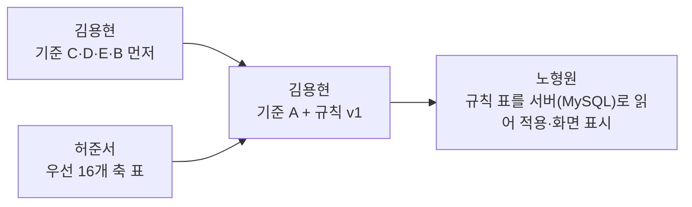

# 추천 기준 점검과 다음 할 일

작성: 노형원 · 작성일: 2026-11-08 · 상태: **제안 (팀 논의 전)**

김용현의 PR #13(비교 축), #14(추천 규칙 v0)를 읽고 두 가지를 정리했어요.
- 추천을 하려면 무엇이 더 필요한가
- 그걸 위해 누가 무엇을 먼저 해야 하는가

숫자는 각 PR의 파일을 2026-11-08에 다시 세어 적었어요.

---

## 1. 김용현 PR 정리 (2026-11-08 기준, 모두 열려 있음)

| PR | 내용 | 비고 |
|---|---|---|
| #4 | 90쌍 판정 초안 1차 검수 | #14가 출처로 씀 |
| #9 | 상황따라 38쌍의 손해·이득 상황 문구 | #14가 출처로 씀 |
| #10 | 겹침 판정 기준 문서화 | 단독 문서 |
| #11 | Claude 기본 기능 × 오픈소스 25쌍 판정 초안 | #14가 출처로 씀 |
| #13 | 분야별 비교 축 v0 (분야당 3~4개), 준서에게 받을 양식 | 추천 기준 1단계 |
| #14 | 추천 규칙 v0: 규칙 53개, 질문 9개(선택지 56개) | 추천 기준 2단계 |

**합치는 순서 제안:** #4 → #9 → #10 → #11 → #13 → #14
- #14가 #4, #9, #11, #13의 파일을 출처로 써요.
- 앞의 PR이 바뀌면 #14의 출처 번호와 문장도 맞춰야 해서, 앞에서부터 합치는 게 안전해요.

---

## 2. 이미 마련된 것

- **결과 종류 5가지:** 정리, 추가, 추가(택1), 기본충분, 주의 (#14 1장)
- **공통 규칙 17개:** 아래 등 (#14 3장)
  - 겹치면 처음 읽는 양이 큰 쪽을 빼기
  - 기본 기능으로 되면 그걸 먼저 보여 주기
  - 같은 종류는 하나만
  - 별 수로는 고르지 않기
  - 판정 없음은 "확인된 정보 없음"
- **근거별 표시 수준:** 직접 시험한 것만 "줄었어요", 문서만 있으면 "효율 확인 안 됨" (#14 3장)
- **분야별 비교 축과 값마다 근거 종류를 붙이는 원칙** (#13)
- **출처 대조:** 규칙이 출처와 맞는지 대조했어요.
- **모의 실행:** 도구함 10가지로 돌려서 모순 0건을 확인했어요 (#14 6장).

---

## 3. 부족한 점: "규칙 목록"은 있고 "규칙을 만드는 기준"은 아직 없어요

규칙 53개는 각각 "이 상황이면 이 도구"예요. 그런데 **왜 그 상황에 그 도구를 고르는지 정하는 기준**은 사실상 "README에 적힌 기능 차이" 하나뿐이에요.

| 규칙의 근거 종류 (`rules_v0.csv`) | 개수 |
|---|---|
| 문서 (`doc`, 약함·일부 확인 안 됨 포함) | 41 |
| 직접 시험 (`tested`, 일부 시험 포함) | 7 |
| AI 추정 (`ai`) | 3 |
| 섞여 있음 | 2 |

비어 있는 기준은 아래 5가지예요. 1번과 5번은 #13, #14에도 "아직 정하지 않음"으로 적혀 있어요.

1. **비교 축이 규칙에 쓰이지 않아요.**
   - #13에서 축을 정했지만 "축 값을 어떻게 비교해서 추천할지"는 미정이에요.
   - #14도 "지금 규칙은 기능 차이만 쓴다"고 적었어요.
2. **후보가 여럿일 때 고르는 기준이 없어요.**
   - 같은 종류 그룹(디자인 지침, DB, 쿠버네티스 등)은 "순서 없이" 보여 줘요.
   - 사용자에게는 결국 "알아서 고르세요"가 돼요.
3. **비용 기준이 없어요.**
   - 추가 규칙은 "그 기능이 필요하면 추천"이에요.
   - 처음 읽는 양이 몇 배여도 추천할지, 어느 선부터 근거를 더 요구할지 정하지 않았어요.
4. **"기본 기능으로 충분"의 판단 기준이 없어요.**
   - 기본충분 규칙 7개와 기본 기능 25쌍은 모두 직접 시험하지 않았어요.
   - 공식 문서나 이름·설명 비교로만 판단했어요.
   - 무엇이 되면 "충분"인지 정의가 없어요.
5. **추천이 맞았는지 보는 기준이 없어요.**
   - 추천을 따랐을 때 무엇이 나아져야 성공인지 정하지 않았어요. 그래서 시험 계획도 없어요.
   - #14에도 "실제로 도움이 되는지는 시험하지 않았다"고 적혀 있어요.

**확인 부탁 (#11):** `builtin_pairs.csv`의 `검수_맞음/틀림/모름` 칸에는 "맞음"이 21개 있어요.
- PR 설명에는 "AI 문서 대조이고 사람 확인이 아니다", "사람 검수는 6·23번"이라고 되어 있어요.
- 이 칸을 사람이 채운 건지 AI가 채운 건지 칸 이름이나 메모에 적어 주세요.

---

## 4. 기준을 어떻게 마련할지 (김용현이 정할 것)

아래 표의 "제안"은 예시예요. 숫자와 방식은 김용현이 정해서 `rules_v0.md`에 **"규칙을 만드는 기준"** 장으로 넣어 주세요.

| | 정할 기준 | 제안 (예시) | 준서 자료가 필요한가 |
|---|---|---|---|
| A | 축으로 후보 고르기 | 질문 선택지와 축 값을 잇는 표를 만들어, 사용자가 고른 필요를 만족하는 후보만 남김. 그래도 여럿이면 B로 | **필요** |
| B | 근거가 없거나 비슷할 때 | 순서 없이 보여 주되, 후보마다 "□□에 비해 다른 점 한 줄"을 같이 보여 줌. 처음 읽는 양은 사실로만 표시 | 일부 (다른 점 한 줄) |
| C | 비용 기준 | 처음 읽는 양이 큰 도구는 직접 시험 근거가 없으면 "참고"로 낮춤. 기준 숫자는 겹침 기준(1,000토큰, 임시)과 맞출지 따로 정할지 결정 | 불필요 (실측 있음) |
| D | 기본충분 | "사용자가 고른 필요를 공식 문서상 기본 기능이 한다"면 "기본 기능으로 충분(문서 기준, 시험 전)"으로 표시 | 불필요 |
| E | 성공 기준과 시험 | 추천을 따른 조합과 원래 조합을 같은 과제로 돌려, ① 과제 결과가 같고 ② 토큰이 줄었는지 봄. 시험 1·2(`judgment/experiments/`) 방식을 재사용 | 불필요 |

**E는 쉬운 것부터** 시작하면 돼요. 예를 들어 #11의 겹침 2쌍이에요.
- 기본 `/security-review`만 쓸 때 vs claude-code-security-review를 더했을 때
- 기본 `/code-review`만 쓸 때 vs open-code-review를 더했을 때

**순서:** C, D, E, B는 준서 자료 없이 지금 정할 수 있어요. A는 준서 자료가 온 뒤에 정해요.

---

## 5. 준서가 먼저 해 줘야 하는 것

**왜 필요한가:**
- 기준 A(축으로 후보 고르기)를 정하려면 도구마다 "무엇을 하는지"가 **같은 형식으로** 적혀 있어야 해요.
- 지금은 README를 각자 읽은 판정 이유 칸이 전부예요.

### 할 일
- **양식:** #13 끝의 **"준서 님께 받고 싶은 양식"**대로 도구마다 1줄씩 채워 주세요.
- **채울 칸:**
  - 축 값
  - 근거 종류
  - 출처
  - 같은 분야의 □□에 비해 다른 점
  - 약한 점
  - 확인 안 됨

### 우선순위: "하나만 골라야 하는" 그룹부터 (#14 R0-09)
지금 규칙이 순서 없이 보여 주는 곳이라 이 자료가 가장 급해요.

| 그룹 | 도구 |
|---|---|
| 절차 전체 | superpowers, ECC, gstack, gsd-core |
| 코드 그래프 | graphify, codegraph, Understand-Anything |
| 디자인 지침 | impeccable, taste-skill, ui-ux-pro-max-skill |
| Figma | Figma-Context-MCP, cursor-talk-to-figma-mcp |
| 범용 DB | dbhub, mcp-toolbox |
| 쿠버네티스 | kubernetes-mcp-server, mcp-server-kubernetes |

이 16개가 끝나면 나머지 도구로 넓혀요.

### 깊이
- **기본:** README와 코드를 읽어서 확인 (`doc`/`calc`)
- **직접 켜서 확인 (`tested`):** "다른 점"이 추천을 가르는 경우에만 해요. 예: "코드만 찾나, 문서도 찾나"
- 직접 시험은 한 도구에 시간이 많이 들어서, 꼭 필요한 곳에만 해요.

### 먼저 볼 자료 (다시 조사하지 않아도 되는 것)
- `features.json`: 스킬·명령·훅·MCP 도구 이름과 개수
- 90쌍과 기본 기능 25쌍의 판정 이유 칸
- `judgment/review/2026-10-18-measure36/side_effects.md`: 켰을 때 생기는 파일·외부 전송
- PR #12의 접근 범위 표
  - 분야 5의 축 ③ "접근 범위"에 그대로 쓸 수 있어요.
  - 지금 하던 위험 검사·접근 범위 작업은 그대로 이어가면 돼요.

### 넘기는 방법 (제안)
- `data/` 폴더(준서 담당)에 표로 올리고 PR로 알려 주세요. 예: `data/compare_axes_v0.csv`
- 김용현이 그 표를 규칙의 출처로 써요.

**답 부탁:** 이 양식 작업을 이미 하고 있는지, 우선 16개를 언제쯤 넘길 수 있는지 이 PR에 적어 주세요.

---

## 6. 순서 정리

- 김용현과 허준서의 첫 단계는 **동시에** 시작할 수 있어요.
- PR #14에서 김용현이 물어본 화면 관련 질문 5개는 노형원이 #14에 따로 답할게요.
