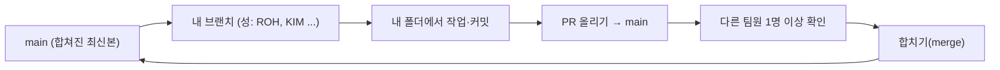

# 프로젝트 진행 방법 (팀 규칙)

이 문서는 세 명이 같은 저장소에서 **서로 파일을 덮어쓰지 않고** 일하기 위한 규칙입니다.
수업에서 배운 브랜치·PR 흐름을 그대로 씁니다. 규칙은 팀이 합의해서 고칠 수 있습니다(고칠 때도 PR로).

## 한눈에 보기



## 1. 브랜치

- **브랜치 이름은 내 성을 영문 대문자로** 씁니다. 예: 노 → `ROH`, 김 → `KIM`. (이미 `ROH`가 있습니다.)
- 브랜치는 **사람마다 하나**를 오래 씁니다. 작업이 한 덩어리 끝날 때마다 PR로 `main`에 합치고, 같은 브랜치에서 이어서 작업합니다.
- `main`에는 **직접 올리지 않습니다.** 항상 PR을 거칩니다.

### 처음 한 번만
```bash
git clone https://github.com/20233014-KYH/New_Project.git
cd New_Project
git switch main
git pull
git switch -c ROH        # ROH 자리에 내 성을 씁니다
git push -u origin ROH
```
이미 내 브랜치가 있으면 `git switch ROH`만 하면 됩니다.

### 작업을 시작할 때마다 (main의 최신 내용을 내 브랜치로 가져오기)
```bash
git switch ROH
git fetch origin
git merge origin/main
```
충돌(conflict)이 나면 혼자 고민하지 말고 팀 채팅에 올리세요. 같이 보면 빨리 끝납니다.

## 2. 폴더: 각자 맡은 폴더만 고칩니다

| 폴더 | 내용 | 담당 (제안서의 역할) |
|---|---|---|
| `data/` | 도구 목록(카드 데이터), 수집 스크립트, 역할 범위 계산 | ① 수집·역할 범위 확인 |
| `judgment/` | 판정 프롬프트, 판정 데이터, 검수 기록 | ② 판정 기준·검수 |
| `web/` | 화면 (React + Tailwind) | ③ 웹 |
| `server/` | 서버 (Spring) | ③ 서버 |
| `docs/` | 기획·판정 기준·진행 방법 문서 | **공동** (수정은 PR 리뷰 필수) |
| `prototype/` | 실험·시험 코드 | 누구나 (이름을 붙여서) |

- 담당자는 아직 정해지지 않았습니다. 정해지면 이 표에 이름을 적습니다. [결정 필요]
- **다른 사람의 폴더를 바꾸고 싶으면** 직접 고치지 말고 PR 코멘트나 이슈로 요청합니다. (Claude로 작업할 때 같은 파일을 서로 고치면 충돌이 가장 많이 납니다.)
- 폴더가 아직 없으면 처음 파일을 올릴 때 만들면 됩니다.

## 3. 작업하고 올리기

### 커밋은 작게, 메시지는 한 줄로
```bash
git add 바꾼파일
git commit -m "data: 토큰 절약 도구 카드 4개 추가"
git push
```
커밋 메시지는 `폴더: 한 일`로 씁니다. 예: `web: 도구함 화면 뼈대`, `judgment: 겹침 판정 프롬프트 초안`, `docs: 9장 의견 반영`.

### PR 올리기
1. GitHub에서 **Compare & pull request**를 누릅니다. (base = `main`, compare = 내 브랜치)
2. 제목은 **`[성] 한 줄 설명`**. 예: `[ROH] 토큰 절약 카드 4개 추가`
3. PR 양식(자동으로 뜸)을 채웁니다: 무엇을 했는지 / 어떻게 확인했는지 / AI가 쓴 부분.
4. **Reviewers에 다른 팀원 1명 이상**을 지정합니다.
5. PR 하나에는 **한 가지 주제만** 담습니다. 파일이 너무 많아지면 나눕니다.

### 리뷰하기 (다른 사람의 PR)
- 실제로 열어서 읽고 **이해가 안 되는 곳은 줄 단위로 질문**합니다. "LGTM"만 남기지 않습니다.
- 확인할 것: ① 맡은 폴더 밖을 건드렸나 ② 키·비밀번호가 들어갔나 ③ 사실이 아닌 내용(출처 없는 숫자, 확인 안 한 도구 설명)이 있나 ④ 문서와 코드가 서로 맞나
- 괜찮으면 **Approve**, 고칠 곳이 있으면 **Request changes**.

### 합치기
- **다른 팀원의 Approve를 받은 뒤**, PR을 올린 사람이 **Merge**합니다.
- 합친 뒤에는 위의 "작업을 시작할 때마다" 순서로 `main`을 내 브랜치에 다시 가져옵니다.

## 4. 이슈로 할 일을 관리합니다
- 할 일은 **GitHub 이슈**로 만듭니다. 제목은 한 가지 일, 본문에 "끝났다고 볼 기준"을 적습니다.
- 하는 사람은 이슈의 **Assignee**에 자기 이름을 넣고, PR 본문에 `closes #번호`를 써서 연결합니다.
- 누가 무엇을 했는지가 이슈·PR·커밋에 남아야 합니다. (수업 평가의 협업 기록이기도 합니다.)

## 5. 꼭 지킬 것

1. **API 키, 비밀번호, 토큰은 절대 올리지 않습니다.** 키는 `.env` 같은 파일에 두고 그 파일은 `.gitignore`로 막습니다(이미 들어 있음). 실수로 올렸으면 **바로 팀에 알리고 키를 새로 발급**합니다. 올린 뒤에 지워도 기록에 남습니다.
2. **확인하지 않은 것을 사실처럼 쓰지 않습니다.** 도구 설명·숫자에는 출처를 달고, 확인 안 했으면 "확인 안 됨"이라고 씁니다. (도구에 대해 "안전하다/위험하다"라고 단정하지 않습니다.)
3. **`docs/`의 기획 문서를 바꿀 때는** 바꾼 이유를 PR에 적고, 다른 문서와 어긋나지 않는지 확인합니다.
4. **도구 목록 변경은** 링크·설치법·라이선스를 직접 열어 확인한 뒤에 올립니다.

## 6. Claude로 작업할 때

세 사람 모두 Claude로 코드와 글을 만듭니다. 그래서 이 규칙을 지킵니다.

- 작업을 시작할 때 Claude에게 **`CLAUDE.md`와 `docs/proposal-ROH.md`를 읽게** 합니다.
- Claude에게 **"내 폴더(`data/` 등)만 수정하라"** 고 분명히 말합니다.
- Claude가 쓴 결과는 **사람이 직접 확인**한 뒤에 커밋합니다. PR 양식의 "어떻게 확인했나"에 무엇을 확인했는지 적습니다.
- Claude가 모르는 도구·버전·수치를 **지어내지 않았는지** 봅니다. 의심되면 원문 링크를 열어 확인합니다.
- 키가 들어간 파일을 Claude에게 보여 주지 않습니다.

## 7. 규칙을 바꾸고 싶을 때
이 문서도 PR로 수정합니다. 이유를 적고 팀원 1명 이상이 동의하면 바꿉니다.
