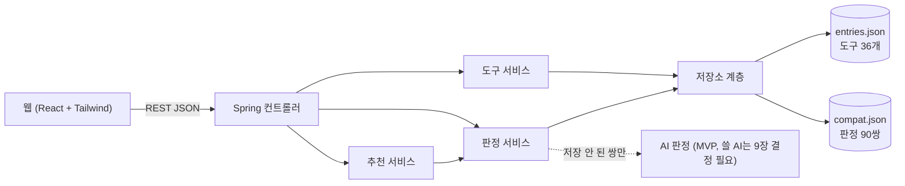

# 서버 와이어프레임: API·데이터 흐름 초안 (Spring, 2026-10-26)

> 기획안 v2.1(`docs/proposal-ROH.md`)의 5장, 6-1, 6-3, 6-5장을 서버 쪽으로 옮긴 **초안**이에요. 기획 내용은 바꾸지 않았어요.
> 기획안 9장에서 아직 정하지 않은 것(판정 저장소 JSON vs DB, 미저장 쌍에 쓸 AI 등)은 **[결정 필요]**로 남겼어요.

## 1. 전체 구조



- **저장소 계층은 인터페이스 하나로 둬요.** 처음에는 JSON 파일을 읽고, 나중에 DB로 바꿔도 위쪽 코드는 그대로예요. [결정 필요: 9장 "판정 저장소"]
- 웹은 목업(`mockup/native/src/api.js`)의 함수 이름을 그대로 쓰고, 안쪽만 `fetch`로 바꾸면 돼요.

## 2. API 목록

목업 `api.js` 주석의 주소 5개에 추천 1개를 더했어요.

| 주소 | 하는 일 | 목업 함수 |
|---|---|---|
| `GET /api/categories` | 분야 6개와 "이럴 때 찾으세요" | `getCategories()` |
| `GET /api/tools?category=&q=&sort=` | 도구 목록(분야, 검색, 정렬: 별 수 / 최근 업데이트) | `getTools()` |
| `GET /api/tools/{id}` | 도구 카드 하나 + 같은 분야의 판정 목록 | `getTool()`, `getSimilar()` |
| `GET /api/judgments?a=&b=` | 두 도구의 판정. 없으면 404 → 화면에 "확인된 정보 없음" | `getJudgment()` |
| `POST /api/box/judge` | 도구함 전체 판정 | `judgeBox()` |
| `POST /api/box/recommend` | 추천(빼기·더하기·교체). **새로 추가** | (새 함수) |

### `POST /api/box/judge`
요청
```json
{ "tools": ["superpowers", "ecc", "caveman"], "memo_tools": ["내가 만든 스킬"] }
```
응답
```json
{
  "pairs": [
    { "a": "ecc", "b": "superpowers", "state": "saved", "relation": "overlap",
      "review_state": "tested", "reason_ko": "...", "evidence": [ ... ], "judged_at": "2026-10-19" },
    { "a": "caveman", "b": "superpowers", "state": "no_info" }
  ],
  "unknown_tools": ["내가 만든 스킬"],
  "range_note": "확인한 쌍의 범위에서만 판단했어요"
}
```
- `state`는 기획안 6-3장 표를 그대로 옮긴 값이에요.

| `state` | 뜻 (6-3장) | 화면 |
|---|---|---|
| `saved` | 저장된 판정 있음 | 판정, 근거, 확인일 |
| `no_info` | 판정이 저장되지 않은 쌍 | **"확인된 정보 없음"** ("안전"이 아님) |
| `outdated` | 판정 뒤 도구가 업데이트됨 | "확인 이후 업데이트 있음(기능 변화는 미확인)" |
| `ai_pending` / `ai_estimate` | API로 판정 중 / 판정함(MVP 포함, 7장) | "AI 추정, 미검수" |
| `failed` | API 실패·한도 초과 | 사실(구성 요소, 토큰)만, "미분석" |

- 쌍은 **정렬·중복 제거**해서 같은 쌍을 두 번 찾지 않아요. 예: (b, a)도 (a, b)로 바꿔서 찾아요.
- 도구가 0~1개면 `pairs`는 빈 목록이에요. 3개 이상이면 `range_note`를 붙여요.
- 목록에 없는 도구는 비교하지 않고 `unknown_tools`에만 넣어요.
- `outdated` 판단: `compat`의 `a_version`·`b_version`과 `entries`의 `version`이 다르면 `outdated`예요.

### `POST /api/box/recommend`
기획안 6-5장 v2.1 순서(쌍 판정 → 효율 근거 → 추천)와 조건 묻기를 따라요.

요청
```json
{ "tools": ["superpowers", "ecc"], "work": "bugfix", "env": { "os": "windows", "shell": "powershell" } }
```
- `work`: `bugfix` / `feature` / `big_logs` / `unknown`, `env`: 조건 묻기 화면에서 받은 값이에요.

응답
```json
{
  "remove": [
    { "tool": "ecc", "because": "overlap", "with": "superpowers", "save_tokens_max": 9169,
      "evidence_type": "tested", "note": "같은 결과에 토큰 약 1.9배(시험 1)" }
  ],
  "add": [
    { "tool": "caveman", "condition_ko": "버그 고칠 때 superpowers 디버깅 절차를 건너뛸 수 있어요",
      "evidence_type": "tested", "pairs_checked": ["superpowers"], "pairs_unknown": ["ecc"] }
  ],
  "replace": [],
  "none_reason": null
}
```
- **빼기**: 도구함 안에서 `overlap`인 쌍. 처음 읽는 양이 큰 쪽을 뺄 후보로 보여 줘요.
- **더하기**: 도구함의 모든 도구와 판정이 있고, `overlap`·`verified_issue`가 아닌 후보만 넣어요.
  - **판정 없는 쌍이 있으면 "통과"가 아니라 `pairs_unknown`에 적어요**(6-5 공통 규칙 1).
  - 효율 근거(`tested`)가 있는 후보만 "더하면 좋아요"로 보여 줘요. 근거가 없으면 "근거 없음"으로 따로 표시해요.
  - 조건 문구는 판정 데이터의 상황 문구에서 가져와요(김용현 #5에서 쓰는 중). 예: rtk는 `env.shell = powershell`이면 "Windows PowerShell에서는 작동 안 함"을 붙여요.
- **교체**: MVP 이후(7장 2단계).
- AI는 후보를 고르지 않고 **이유 문장만** 다듬어요(6-5).
- 지금 데이터로 되는 것: 빼기 3쌍, 더하기는 시험한 후보(caveman, rtk)만 가능해요.

## 3. 데이터
- 형식은 기획안 6-1장 그대로예요. 실제 값으로 만든 샘플: `server/sample-data/entries.json`(36개), `server/sample-data/compat.json`(90쌍)
- 만드는 스크립트: `server/tools/build_sample_data.py` (노형원 컴퓨터의 실험 폴더 기준이라 그대로는 안 돌아요)
  - 실측표, GitHub 정보, 김용현 1차 검수표를 읽어서 만들어요.
- **비어 있는 값**: `summary_ko`, `role_summary`, `install`, `token_effect`, `reviews`
  - 기획안 9장 "role_summary 작성과 검수 방법"이 정해지면 채워요.
- `always_on_tokens_est`에는 실측값을 넣었어요(v2.1). `token_note`에 측정일과 Claude Code 버전을 적었어요.
- `review_state`: `tested`(시험 3쌍) / `human_review`(김용현 확인 87쌍) / `ai_estimate`(아직 없음)

**Spring 쪽 클래스 (초안)**

| 클래스 | 하는 일 |
|---|---|
| `Tool`, `Scope`, `AutoMeta` | `entries.json` 한 건 |
| `Judgment`, `Evidence` | `compat.json` 한 건 |
| `ToolRepository`, `JudgmentRepository` | 인터페이스. `JsonToolRepository`부터 만들고 DB는 나중에 |
| `JudgmentService.judgeBox()` | 쌍 만들기 → 정렬·중복 제거 → 저장 판정 찾기 → `state` 붙이기 |
| `RecommendService` | 위 규칙. 판정은 `JudgmentService`를 다시 씀 |
| `PairKey` | (a, b)를 늘 같은 순서로 바꾸는 값 객체 |

## 4. 지키는 것 (기획안 그대로)
- 분석하지 않은 쌍은 **"안전"이 아니라 "확인된 정보 없음"**이에요(6-1 핵심 규칙).
- "안전합니다" 같은 단정 표현은 응답 문구에 넣지 않아요(6-6).
- 도구 설명은 **분석 자료로만** 다뤄요. AI에게 넘길 때 명령으로 읽히지 않게 해요(6-3, 프롬프트 주입 대비).
- 요청당 도구 수에 상한을 둬요(6-3). 숫자는 [결정 필요].

## 5. [결정 필요] (기획안 9장에 이미 있는 것)
- 판정 저장소: JSON으로 시작할지, 처음부터 DB를 쓸지
- 미저장 쌍 API: 쓸 AI, 하루 금액 상한, 호출 제한
- 위험 표시 방식: 6-6장 vs 허준서 안. 도구 카드 응답에 위험 신호 필드를 넣을지가 이 결정에 달렸어요.
